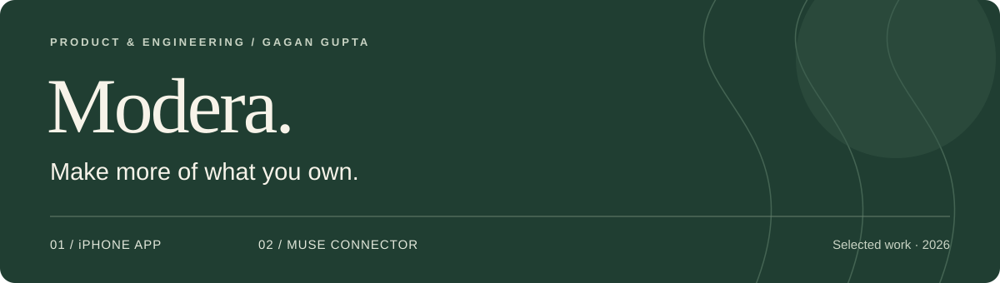
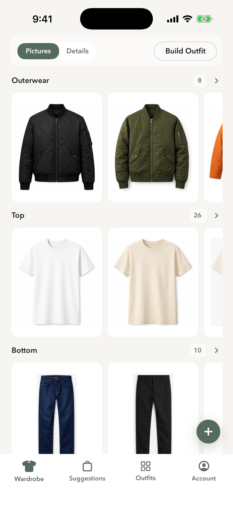
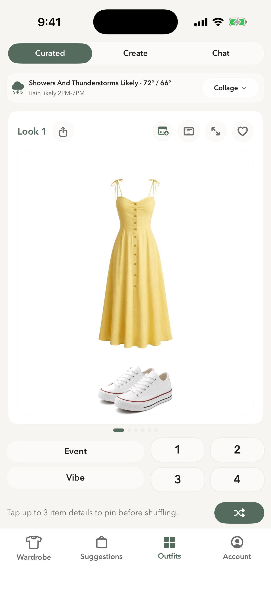
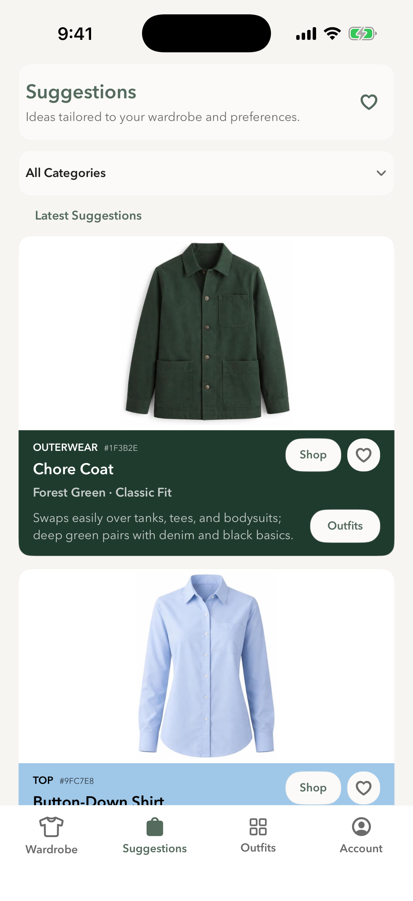
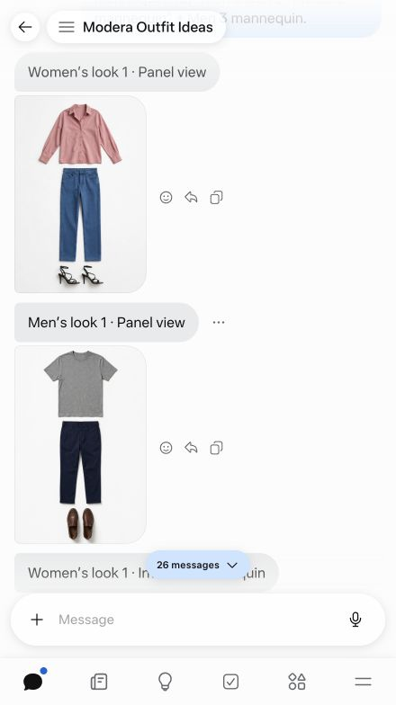
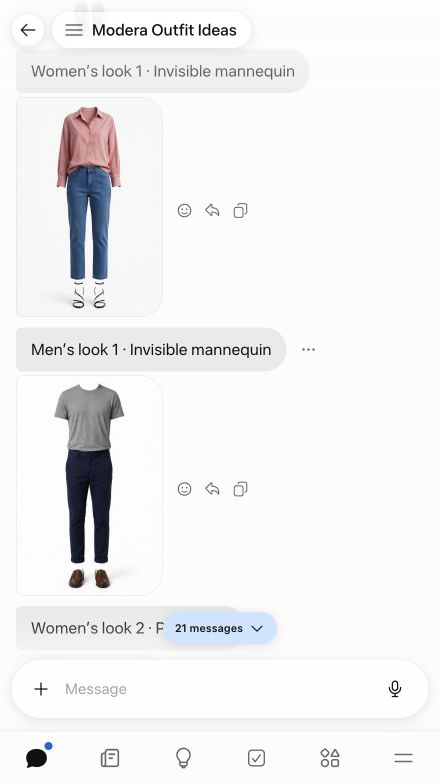

  

  <a href="https://apps.apple.com/us/app/modera-style/id6781372920"><strong>iPhone app</strong></a> &nbsp;·&nbsp;
  <a href="https://www.modera.fyi/muse"><strong>Muse connector</strong></a> &nbsp;·&nbsp;
  <a href="https://www.modera.fyi/">Product website</a> &nbsp;·&nbsp;
  <a href="docs/architecture.md">Architecture</a>

# Modera · Product & engineering showcase

**An iPhone wardrobe app and a conversational styling connector, built by Gagan Gupta.**

Modera helps people answer two connected questions: *What can I wear with what I already own?* and *What would make my wardrobe more useful?* I built the native app experience and extended Modera's outfit engine into Muse, bringing wardrobe organization and styling into a conversation.

This repository presents the products, design decisions, and system architecture. **Application source and proprietary outfit logic are private.**

## Two ways to use the same wardrobe intelligence

| | Modera Style | Modera for Muse |
| :--- | :--- | :--- |
| **Experience** | A visual wardrobe and outfit planner for iPhone | Wardrobe building and outfit suggestions inside Muse |
| **Core workflow** | Catalog → combine → save → wear again | Import → describe → request → visualize |
| **Product focus** | Make a personal closet easier to browse and use | Make styling accessible through conversation |
| **Availability** | [Published on the App Store](https://apps.apple.com/us/app/modera-style/id6781372920) | [Guided installation; limited API access](https://www.modera.fyi/muse) |
| **Case study** | [Designing the app →](docs/modera-style.md) | [Building the connector →](docs/muse-connector.md) |

## 01 / Modera Style

A native experience that connects the clothes someone owns with outfit ideas, shopping suggestions, and a history of looks worth repeating.

<table>
  <tr>
    <th align="center">Organize a wardrobe</th>
    <th align="center">Find a combination</th>
    <th align="center">Shop with context</th>
  </tr>
  <tr>
    <td width="33%"></td>
    <td width="33%"></td>
    <td width="33%"></td>
  </tr>
</table>

**What I built:** wardrobe capture and browsing, outfit discovery with event and weather context, saved looks and wear history, and suggestions grounded in the existing closet.

**Selected decision:** let people keep pieces they like and reshuffle the rest. Styling becomes an editable decision rather than a single recommendation to accept or reject.

[Explore the app case study →](docs/modera-style.md)

## 02 / Modera for Muse

A connector that turns photos and permitted clothing receipts into a wardrobe inside Muse, then requests outfit suggestions from Modera's private engine. No iPhone app is required.

<table>
  <tr>
    <th align="center">See the individual pieces</th>
    <th align="center">See the assembled look</th>
  </tr>
  <tr>
    <td width="50%" align="center"></td>
    <td width="50%" align="center"></td>
  </tr>
</table>

*Sample wardrobes · AI-generated garment imagery. Modera selected the combinations; Muse generated their appearance. These examples contain no personal wardrobe or photos.*

**What I built:** wardrobe tools, a protected API connection, a shared outfit engine, and verified updates that preserve existing wardrobe records.

**Selected decision:** send clothing facts to the outfit service while keeping photos, garment images, conversations, and saved outfits inside Muse. Muse is a hosted environment; this is a boundary between services, not a claim that processing stays on the user's device.

[Explore the connector case study →](docs/muse-connector.md)

## How the pieces fit

The app uses native iOS UI and persistence with Firebase services. The connector uses a separate Muse wardrobe and a protected API that runs a shared Swift outfit engine. Reusing outfit logic does **not** synchronize wardrobes between the products.

| Layer | Technologies |
| :--- | :--- |
| Native app | Swift, SwiftUI, SwiftData, WeatherKit |
| App services | Firebase Authentication, Firestore, Storage, Cloud Functions |
| Muse tools | Python, Pillow, Muse's native image capabilities |
| Outfit service | TypeScript, Node.js, Swift, Google Cloud Run |
| Connection | OAuth with PKCE, credential rotation and revocation |

[Architecture and data boundaries →](docs/architecture.md)

## Live products and demonstrations

The App Store listing identifies me as the developer. The app images here are the product screenshots used on Modera's website. The connector examples are captured from Muse using fictional garments to demonstrate outfit selection and display. See the linked product pages for current availability and connector access limits.

[Visual provenance →](assets/README.md)

---

**Gagan Gupta** · Creator of Modera · [GitHub](https://github.com/gkgstudios) · [Modera](https://www.modera.fyi/)

© 2026 Gagan Gupta. Product names and third-party interfaces belong to their respective owners. This is a portfolio showcase, not an open-source release of the products.
