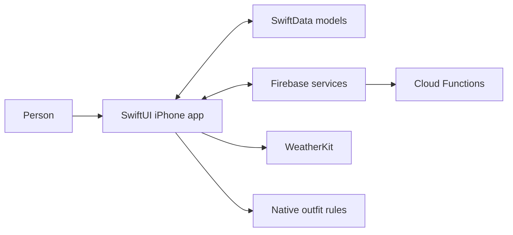
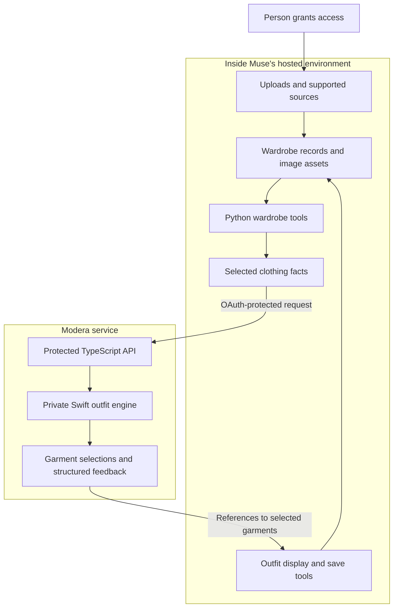

# Architecture and data boundaries

[Back to showcase](../README.md)

Modera has two product experiences with separate wardrobes. The connector reuses the app's outfit-engine lineage; it does not read the app's user database or synchronize wardrobe records with it.

## Native iPhone app

The app combines native wardrobe browsing and outfit presentation with cloud authentication, data, images, and backend operations. Its data practices are described in the [App Store listing](https://apps.apple.com/us/app/modera-style/id6781372920) and [product website](https://www.modera.fyi/).

## Muse connector

| Information | Boundary |
| :--- | :--- |
| Source photos and garment images | Remain in Muse; not submitted to the Modera outfit API |
| Conversations, receipts, and purchase history | Remain in Muse; not submitted as outfit request content |
| Selected clothing facts | Sent to Modera for outfit processing |
| Outfit selections and structured feedback | Returned to Muse for display and saving |
| Credentials | Managed through protected connection mechanisms |
| Operational records | The service retains authorization, admission, and operational data; this is not a zero-storage service |

These boundaries describe the connector. They are not a claim that Muse is offline, that its host retains no data, or that the iPhone app uses the same storage model.

## Reliability choices

- **Validate the contract.** Check the selected metadata and returned garment references at the integration boundary.
- **Handle sparse wardrobes.** Support product-appropriate constraints and structured feedback when inputs do not produce an outfit.
- **Preserve facts.** Keep generated presentation assets separate from the evidence used to describe clothing.
- **Check revisions.** Detect wardrobe changes before a result is displayed or saved against stale records.
- **Verify releases.** Validate downloaded files and compatibility before replacing connector tools; preserve data outside the installation directory.

## What this repository contains

This is an independently created documentation repository containing case studies, diagrams, and selected product images. It includes no application source, scoring implementation, backend configuration, credentials, private wardrobe data, or history from the implementation repositories.

The diagrams intentionally describe responsibilities and data flow at a high level. They are not deployment specifications or a complete account of internal algorithms.
