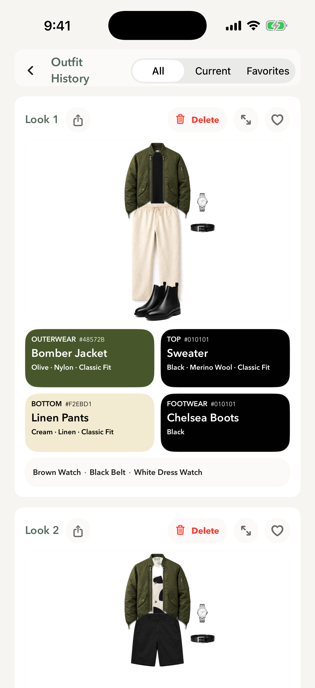

# Modera Style

**A visual wardrobe that helps people make more of the clothes they own.**

[Back to showcase](../README.md) · [View on the App Store](https://apps.apple.com/us/app/modera-style/id6781372920)

## The problem

A closet can be full of clothes and still feel difficult to use. Remembering every item, finding combinations, and deciding whether a new purchase fits the rest of the wardrobe are related tasks. Modera brings them into one product.

## My contribution

I built the native iPhone experience and its supporting services: the wardrobe model and browsing interface, outfit discovery, visual presentation, saved looks, wear tracking, and wardrobe-aware shopping suggestions. The work spans product design, SwiftUI development, persistence, and backend integration.

## The experience

1. **Build a wardrobe.** Add items through photos, catalog choices, or clothing details. Browse by category and switch between imagery and structured information.
2. **Find an outfit.** Explore combinations with event, style, and weather context. Keep preferred pieces and reshuffle the remainder.
3. **Save and revisit.** Keep favorite looks, plan outfits on a calendar, and track item usage.
4. **Consider a purchase.** Evaluate suggestions in the context of an existing closet, with explanations of how a piece can be worn.

<table>
  <tr><th align="center">From a wardrobe</th><th align="center">To a reusable look</th></tr>
  <tr>
    <td width="50%" align="center"></td>
    <td width="50%" align="center"></td>
  </tr>
</table>

## Decisions that shaped the product

| Decision | Reasoning |
| :--- | :--- |
| Start with owned clothing | Make the existing wardrobe useful before suggesting another purchase. |
| Pair images with structured attributes | Pictures help people browse; garment facts support filtering and outfit decisions. |
| Allow partial control over an outfit | A user may know which jacket they want to wear while still needing help with the rest. |
| Connect discovery with history | A useful look should remain available after the recommendation session ends. |
| Bring weather into the experience | Outfit suggestions need to fit the day as well as the occasion. |

## Engineering

SwiftUI provides the interface, with SwiftData for local models and Firebase services for authentication, cloud data, images, and backend operations. WeatherKit supplies weather context. Outfit construction combines structured garment attributes and styling rules; conversational features use backend services.

The app and Muse connector have different storage boundaries. The app uses its own cloud services, including image storage. The connector keeps its wardrobe and images inside Muse and calls a separate outfit API. The connector's privacy model should not be read as the app's privacy policy.

## Delivery and evidence

Modera Style is published on the App Store under Gagan Gupta. The screenshots in this case study come from Modera's product website and illustrate the wardrobe, styling, suggestions, and history experience. The public listing is the reference for current availability and app privacy information.

**A principle carried into the connector:** keep the wardrobe understandable and the recommendation editable. A useful styling system needs to let people inspect, correct, and reuse its output.

[Next: the Muse connector →](muse-connector.md)
